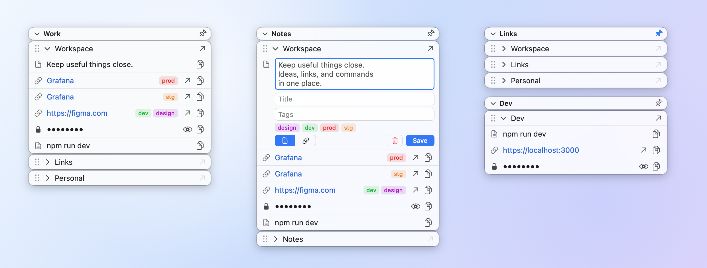

# StickSpace

Sticky snippets for the macOS menu bar: keep texts, links, commands and secrets in small floating glass windows, copy them in one click, open links without leaving your app, and share a set of them with your team through Git.

<p align="center">
  <picture>
    <source media="(prefers-color-scheme: dark)" srcset="docs/readme/spaces-dark.png">
    
  </picture>
</p>

## What it is

- An **entity** is one piece of text or one link. A **group** is a named list of entities. A **space** is a window of groups, with its own header that is always visible.
- Lives only in the menu bar (no Dock icon). No account and no server. It works offline; the network is used only when you connect a Git repository.
- Liquid Glass on macOS 26, standard materials on macOS 14 and 15. Light, dark or system theme.

## Everyday use

- **Copy** any entity with one click (exactly its text, nothing added).
- **Links**: a Link entity whose text is a full http(s) address gets an open button. Click opens the browser; **⌘-click opens it in the background** and keeps StickSpace active. The arrow in a group's title opens all its visible links at once, without duplicates.
- **Titles and tags**: an entity can have a title that is shown instead of a long text or link (copy and open still use the real value), and tags such as `prod`, `stg`, `dev` shown as coloured chips.
- **Mask** hides a secret on screen as `••••••••`; reveal it temporarily with the eye; copy works without revealing. Masking is visual only, nothing is encrypted.
- **Edit in place**: double-click an entity (text, title, tags, type Text or Link). **Drag** to reorder groups and entities.
- **Fold**: double-click a group's title to expand or collapse it, or the space header to fold all its groups. **Single** (space menu) keeps only one group open at a time.
- **Pin** (in the space header) locks the window in place. Drag a window's left or right edge to change its width.
- **Hide** a group or an entity (right-click) without deleting it; **Show Hidden** lists hidden items again.
- **Zoom** per space, 60% to 200% in steps of 10%: ⌘+ / ⌘− / ⌘0 or the space menu.
- **Delete** is immediate and undoable (⌘Z or the notice).
- **Right-click** the space header, a group or an entity for everything else. The menu bar icon has New Space, Import, a check mark per space to show or hide its window, the theme switch, Restart and Quit.

## Sharing through Git

A space can come from a repository, so a team keeps its links and commands in one place (a GitLab project, for example) and changes them with the usual branch and merge request.

- **Import → GIT**: a *space file* becomes a new space with all its groups; a *group file* is added to a space you already have. Groups you do not want are hidden (a local choice).
- **Sync** brings in what others changed, with a three-way merge. If you both changed the same entity, yours is kept and **Revert** returns the repository's version. The app also checks for updates in the background every few hours; it only tells you, you press Sync.
- **Push** sends your edits to a new branch (a merge request opens on GitLab) after syncing. Tags are read-only.
- **Export → GIT** publishes your own space or group to a repository the same way, and links it. After the merge request is merged, a teammate imports it.
- Masked entities and custom groups never leave your Mac. Credentials are yours: it uses the system `git`, your ssh agent or credential helper, or an ssh key you point to. Needs `git` (`xcode-select --install`).

How the files look in a repository: [`docs/examples`](docs/examples/README.md). The decisions behind it: [`docs/design/git-sync.md`](docs/design/git-sync.md).

## Import and export as JSON

The Import and Export windows (resizable) have a JSON tab: paste to import, copy to export. Masked entities are left out of an export unless you tick the option. The format is versioned (version 2; version 1 files are still read).

<p align="center">
  <picture>
    <source media="(prefers-color-scheme: dark)" srcset="docs/readme/windows-dark.png">
    
  </picture>
</p>

## Install

```
brew install --cask caskbrew/tap/stickspace
```

Or download `StickSpace-<version>.zip` from [Releases](https://github.com/caskbrew/StickSpace/releases), unzip and move `StickSpace.app` to `/Applications`.

The app is ad-hoc signed and **not notarized**. The Homebrew cask clears the quarantine flag for you; with a manual download, right-click the app and choose Open the first time (or run `xattr -dr com.apple.quarantine /Applications/StickSpace.app`).

Requires macOS 14 or later (universal binary: Apple silicon and Intel).

## Your data

Everything is stored in `~/Library/Application Support/Stickspace/state.json` (plain JSON). Delete it to start fresh. Git clones live next to it in `remotes/`.

## Build from source

Needs Xcode and [XcodeGen](https://github.com/yonaskolb/XcodeGen).

```
xcodegen generate
xcodebuild -project Stickspace.xcodeproj -scheme Stickspace -configuration Release -derivedDataPath build build
open build/Build/Products/Release/StickSpace.app
```

A Debug build is a separate app, **StickSpace Dev** (bundle id `com.sgoroshko.stickspace.dev`, data in `~/Library/Application Support/Stickspace Dev/`), so it can run next to the installed one without touching its data.

Tests (about 100; the Git ones run the real `git` against a temporary local repository):

```
xcodebuild -project Stickspace.xcodeproj -scheme Stickspace -destination 'platform=macOS' test -derivedDataPath build
```

The Debug build can also write documentation screenshots of every window in both themes: `STICKSPACE_NAME=StickSpace STICKSPACE_SCREENSHOTS=$PWD/docs/screens build/Build/Products/Debug/StickSpaceDev.app/Contents/MacOS/StickSpaceDev`.

## License

Apache License 2.0, see [LICENSE](LICENSE).
