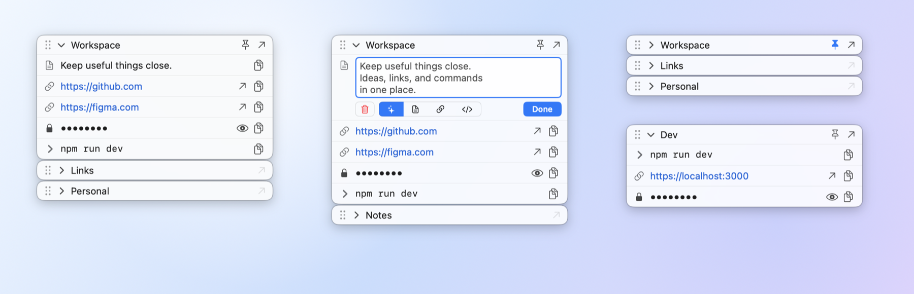
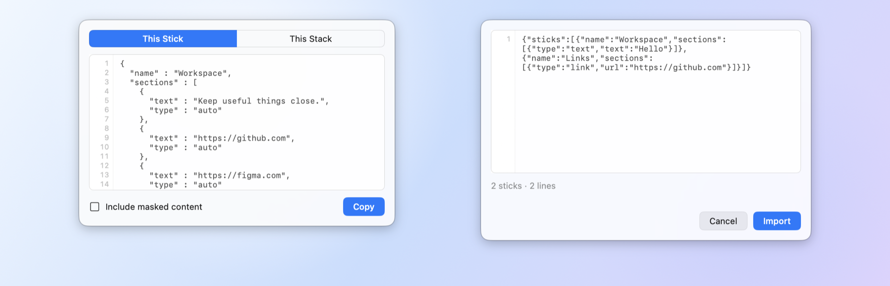

# StickSpace

Sticky snippets for the macOS menu bar: keep texts, links, commands and secrets in small floating glass windows, copy them in one click, open links without leaving your app.

<p align="center">
  <picture>
    <source media="(prefers-color-scheme: dark)" srcset="docs/readme/stacks-dark.png">
    
  </picture>
</p>

## What it is

- **Line**: one piece of text. **Stick**: a named list of lines. **Stack**: sticks grouped in one window.
- Lives only in the menu bar (no Dock icon). Local-only: no account, no server, no network.
- Liquid Glass on macOS 26, standard materials on macOS 14 and 15. Light, dark or system theme.

## Features

- **Copy** any line with one click (exact text, nothing added).
- **Links**: a line that is a full http(s) address gets an open button. Click opens the browser; **⌘-click opens it in the background** and keeps Stickspace active. The arrow in a stick's title opens all its visible links at once, de-duplicated.
- **Mask Content**: hide secrets on screen with `••••••••`; reveal temporarily with the eye; copy works without revealing. Masking is visual only, nothing is encrypted.
- **Pin** a stack to lock its window in place (pinned windows cannot be dragged away).
- **Double-click** a stick's title to expand or collapse. **Drag** to reorder sticks and lines. Double-click a line to edit it inline (Auto / Text / Link / Code).
- **Right-click** a stick or a line for everything else: rename, hide/show, add sticks, zoom, import/export, delete (⌘Z undoes).
- **Zoom per stack**: ⌘+ / ⌘− / ⌘0.
- **Import / Export** as versioned JSON (paste to import; masked lines are excluded from export unless you opt in).
- Menu bar: New Stack, Import, show/hide each stack, theme switch, Restart, Quit.

<p align="center">
  <picture>
    <source media="(prefers-color-scheme: dark)" srcset="docs/readme/windows-dark.png">
    
  </picture>
</p>

## Install

```
brew install --cask caskbrew/tap/stickspace
```

Or download `Stickspace-<version>.zip` from [Releases](https://github.com/caskbrew/StickSpace/releases), unzip and move `Stickspace.app` to `/Applications`.

The app is ad-hoc signed and **not notarized**. The Homebrew cask clears the quarantine flag for you; with a manual download, right-click the app and choose Open the first time (or run `xattr -dr com.apple.quarantine /Applications/Stickspace.app`).

Requires macOS 14 or later (universal binary: Apple silicon and Intel).

## Your data

Everything is stored in `~/Library/Application Support/Stickspace/state.json` (plain JSON). Delete it to start fresh.

## Build from source

Needs Xcode and [XcodeGen](https://github.com/yonaskolb/XcodeGen).

```
xcodegen generate
xcodebuild -project Stickspace.xcodeproj -scheme Stickspace -configuration Release -derivedDataPath build build
open build/Build/Products/Release/Stickspace.app
```

Tests: `xcodebuild -project Stickspace.xcodeproj -scheme Stickspace -destination 'platform=macOS' test -derivedDataPath build`

## License

Apache License 2.0, see [LICENSE](LICENSE).
